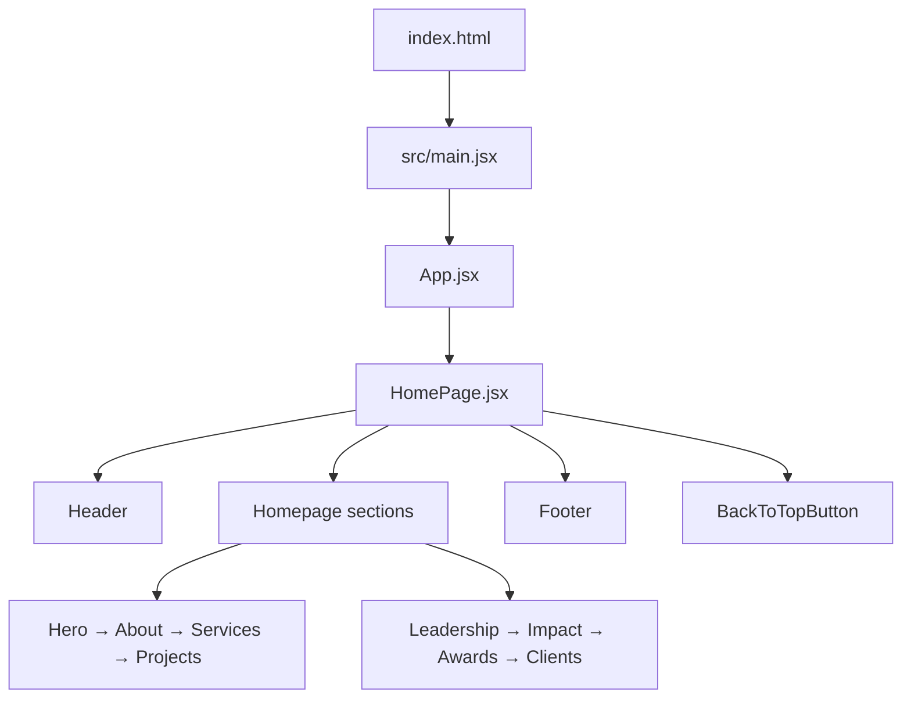

# Technical Architecture

## Stack and commands

| Item | Verified version / role |
| --- | --- |
| React / React DOM | `19.3.1`; UI rendering |
| Vite | `8.3.6`; dev server and production bundling |
| `@vitejs/plugin-react` | `6.1.2`; JSX Fast Refresh pipeline |
| Tailwind CSS / Vite plugin | `4.3.5`; utility classes via `src/index.css` |
| Swiper | `14.4.0`; about, projects, and awards carousels |
| lucide-react | `1.73.0`; installed; usage not verified in `src/` |
| ESLint | `10.14.0`; React hooks/refresh config |

Use `npm run dev`, `npm run build`, `npm run lint`, and `npm run preview`. Vite configuration is [vite.config.js](../vite.config.js): React and Tailwind Vite plugins only. `index.html` loads Inter, Gantari, and Red Hat Display from Google Fonts.

## Entry and composition

There is no React Router: hash links navigate among sections. `HomePage` is the source-of-truth rendering order.

## Folder map

| Path | Purpose |
| --- | --- |
| `src/main.jsx`, `src/App.jsx`, `src/pages/HomePage.jsx` | React bootstrap, CSS import, composition |
| `src/components/layout/` | Header/footer |
| `src/components/sections/` | All eight homepage feature sections |
| `src/components/common/` | `Reveal`, `SectionLabel`, `ActionLink`, `BackToTopButton` |
| `src/components/animations/CountUp.jsx` | Digit-reel counter view |
| `src/hooks/` | `useReveal`, `useCountUp` observer/layout behavior |
| `src/utils/formatNumber.js` | Indian-locale numeric formatting |
| `src/data/siteContent.js` | Additional site data; current feature sections primarily define/import their own data |
| `src/styles/site.css` | Global tokens, custom layout/component/responsive styles |
| `src/index.css` | Tailwind v4 entry (`@import "tailwindcss"`) and pulse keyframes |
| `src/assets/images/`, `src/assets/videos/` | Bundled runtime media; `bann.mp4` is the hero video |
| `public/` | Static favicon/icons |
| `ref folder/`, `src_backup/` | Reference/backup material; not imported by runtime code |

## Behavior and data flow

- Component-local state powers header drawer/dropdowns/scrolled state, hero sound state, project category, and awards Swiper instance.
- `ProjectsSection` creates/destroys imperative Swiper instances on active category changes. `AboutSection` creates/destroys one Swiper with Navigation and Autoplay. `AwardsSection` uses `swiper/react` state to call `slidePrev/slideNext`.
- `Reveal` wraps elements and uses `useReveal`/`IntersectionObserver`; Tailwind transition classes perform a 750 ms cubic-bezier reveal.
- `CountUp` uses `formatNumber`, a measured line height, and a per-digit transform reel. `useCountUp` uses `ResizeObserver` plus `IntersectionObserver` (threshold `0.5`).
- `BackToTopButton` mutates the SVG dash offset in `requestAnimationFrame`; React state changes only when visibility crosses 200 px.

## Styling and responsive architecture

- Tailwind v4 utilities are available through [index.css](../src/index.css), while [site.css](../src/styles/site.css) holds reset, variables, exact reference CSS, complex selectors, Swiper, and media queries.
- CSS uses `--color-*`, `--font-*`, `--container-width: 1416px`, and `--section-gap: 120px` root variables.
- Tailwind utilities are in a cascade layer; unlayered custom CSS can override them. The impact and awards sections use scoped semantic classes specifically to prevent this regression.
- Main responsive thresholds in `site.css` include 1599, 1199, 991, 767, 575, and 479 px; component utilities add equivalent `max-[...]` breakpoints.

## Media strategy

Runtime images are ESM imports, giving Vite hashed production assets. Below-fold leadership, clients, projects, and award images commonly use `loading="lazy"`; leadership also uses `decoding="async"`. Hero video uses `preload="metadata"` and a poster. Background images are inline `backgroundImage` styles where overlays are required.

## Build/deployment

`npm run build` invokes `vite build`, writing `dist/`. No CI, deployment target, environment variables, or server/API configuration is present. Validate source edits with ESLint where relevant and always build before handoff.
